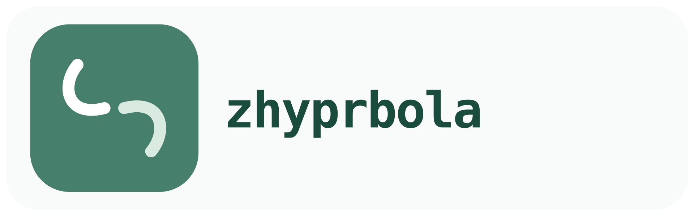
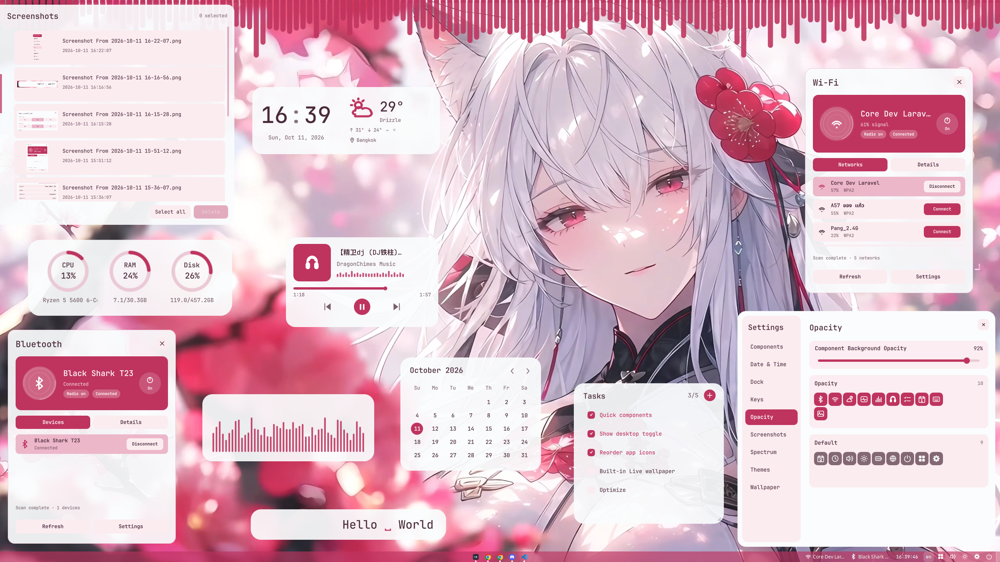

# Zhyprbola





## Stack

```text
Shell:   GNOME Shell Extension (GJS)
Panels:  Qt Quick / QML
Backend: C++ / Qt
Build:   qmake6 + make
```

## Setup

```bash
# Debian/Ubuntu base tools
sudo apt install qt6-base-dev qt6-declarative-dev qmake6 gnome-shell-extensions \
    libxkbcommon-dev libglib2.0-dev acl

# Optional runtime helpers
sudo apt install qml6-module-qtquick-controls playerctl cava network-manager bluez

# Optional brightness control for external monitors with DDC/CI enabled
sudo apt install ddcutil

# Optional AT-SPI support for Key Visualizer
# GNOME may deny global keyboard monitoring
sudo apt install gjs gir1.2-atspi-2.0 gir1.2-gtk-4.0
```

## Run

```text
Install
==========

Build the QML panel host, install the local GNOME extension, and enable the dock.

Reload
----------

The dock may appear immediately. If GNOME does not load the updated extension,
log out and back in. Some sessions or machines may need that after each update.
```

```bash
make dock
```

## Dock

```bash
# Run these commands from the project directory.

# Disable the dock while keeping the extension installed
make dock-disable

# Enable the installed dock again
make dock-enable

# Uninstall the local GNOME extension
make dock-remove
```

```text
Removal
==========

Removing the dock keeps the project files and settings in ~/.config/zhyprbola.
Run make dock to build, reinstall, and enable it again.
```

## Documentation

- [Documentation](docs/README.md)
- [Development](docs/development.md)
- [Key Capture and Security](docs/key-capture.md)
- [v0.1.0](docs/release/v0.1.0.md)

## MIT [License](LICENSE)
